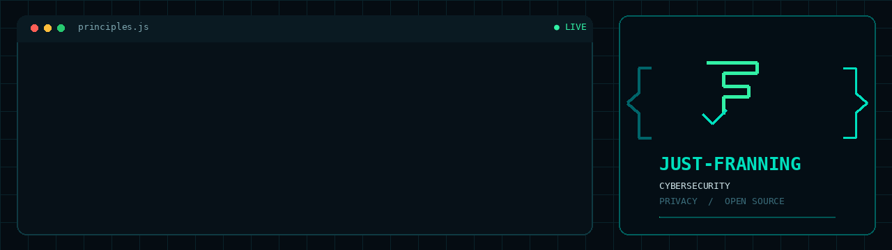

 

  

  

<h1 align="center">Just-Franning</h1>

  <strong>Security by Design · Privacy by Default · Open Source</strong>

  <a href="#english">English</a> ·
  <a href="#deutsch">Deutsch</a> ·
  <a href="https://github.com/Just-Franning/Just-Franning">Repository</a>

---

## 🇬🇧 English

### About me

Welcome to my GitHub profile.

I'm focused on IT security, privacy-conscious engineering, and open-source development. I enjoy exploring security challenges and building practical solutions with an emphasis on transparency, reliability, and user control.

My guiding principles:

- **Security by Design** — Security belongs in every stage of development.
- **Privacy by Default** — Minimize unnecessary data collection and exposure.
- **Transparency** — Prefer understandable implementations and clear documentation.
- **Open Source** — Encourage collaboration, inspection, and reproducibility.
- **Practical Security** — Focus on solutions that address real-world problems.

### Featured project

#### [Emberwatch](https://github.com/Just-Franning/Emberwatch)

A project in my security-focused development portfolio.

Visit the repository to explore its current functionality, implementation, and documentation.

### Areas of interest

- Cybersecurity and defensive security
- Privacy engineering and data minimization
- Secure software development
- Open-source security tooling
- Automation and technical experimentation
- Documentation and reproducible workflows

### Technology

I select technologies based on each project's requirements, security objectives, and maintainability. My goal is to build solutions that are practical, understandable, and mindful of privacy.

### Explore

- [My repositories](https://github.com/Just-Franning?tab=repositories)
- [My GitHub profile](https://github.com/Just-Franning)
- [Emberwatch](https://github.com/Just-Franning/Emberwatch)

---

## 🇩🇪 Deutsch

### Über mich

Willkommen auf meinem GitHub-Profil.

Mein Fokus liegt auf IT-Sicherheit, datenschutzorientierter Entwicklung und Open Source. Ich beschäftige mich gerne mit Sicherheitsherausforderungen und entwickle praktische Lösungen, bei denen Transparenz, Zuverlässigkeit und Nutzerkontrolle im Mittelpunkt stehen.

Meine Leitprinzipien:

- **Security by Design** — Sicherheit gehört in jede Phase der Entwicklung.
- **Privacy by Default** — Unnötige Datenerhebung und Datenoffenlegung minimieren.
- **Transparenz** — Verständliche Implementierungen und klare Dokumentation bevorzugen.
- **Open Source** — Zusammenarbeit, Überprüfbarkeit und Reproduzierbarkeit fördern.
- **Praxisorientierte Sicherheit** — Lösungen für reale Herausforderungen entwickeln.

### Ausgewähltes Projekt

#### [Emberwatch](https://github.com/Just-Franning/Emberwatch)

Ein Projekt aus meinem sicherheitsorientierten Entwicklungsportfolio.

Im Repository findest du Informationen zu den aktuellen Funktionen, zur Implementierung und zur Dokumentation.

### Interessengebiete

- IT-Sicherheit und defensive Security
- Privacy Engineering und Datenminimierung
- Sichere Softwareentwicklung
- Open-Source-Sicherheitstools
- Automatisierung und technische Experimente
- Dokumentation und reproduzierbare Workflows

### Technologien

Ich wähle Technologien passend zu den Anforderungen, Sicherheitszielen und der langfristigen Wartbarkeit eines Projekts aus. Mein Ziel sind praktische, nachvollziehbare und datenschutzbewusste Lösungen.

### Weitere Links

- [Meine Repositories](https://github.com/Just-Franning?tab=repositories)
- [Mein GitHub-Profil](https://github.com/Just-Franning)
- [Emberwatch](https://github.com/Just-Franning/Emberwatch)

---

  <strong>Security by Design · Privacy by Default · Open Source</strong>

  Built with purpose. Designed with privacy in mind.

